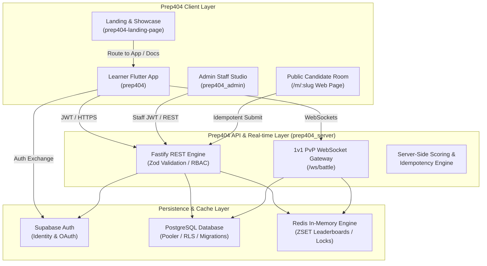
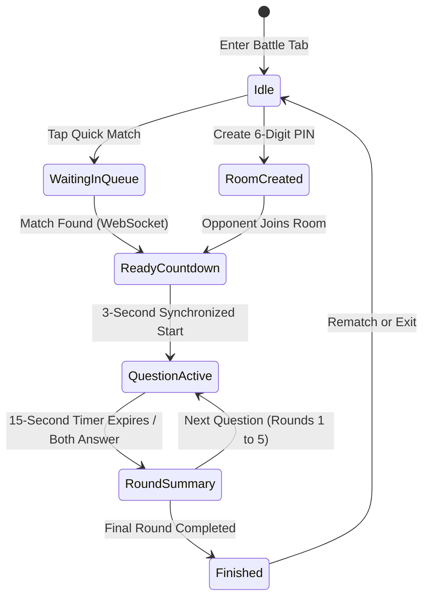
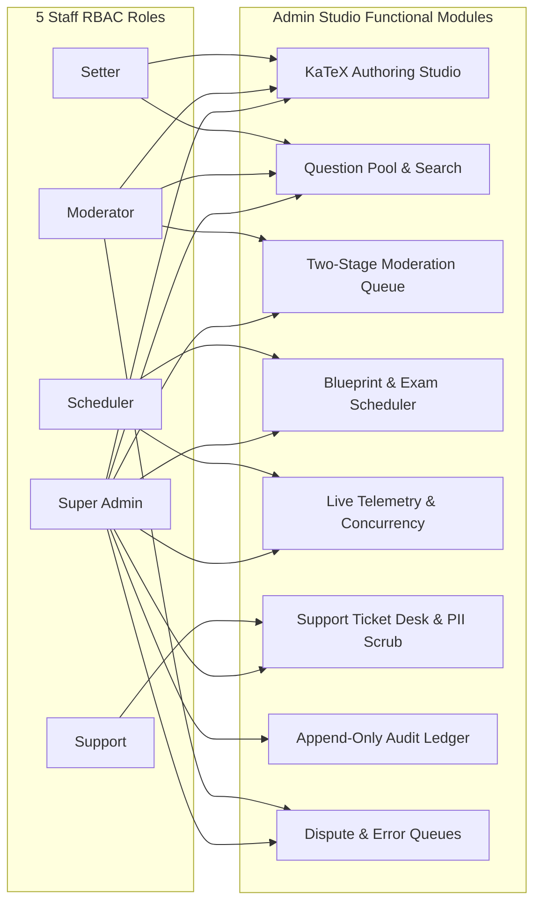
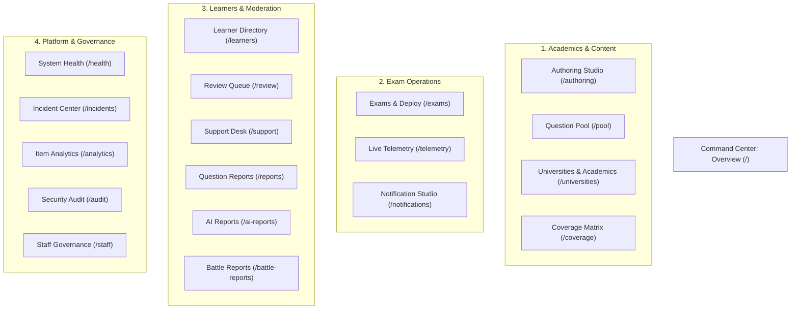

# Prep404 — Complete Platform Feature Specification & System Architecture

> **Prep404** (Brand Motto: *"Failure Not Found"*) is an enterprise-grade competitive examination and university admission preparation platform engineered and operated by **FourZeroFour Technologies**, tailored specifically for Bangladeshi higher-education admission aspirants (Engineering, Medical, University General / GST, and Elite Private Universities) and global standardized test-takers.

---

## 1. **Executive Product Overview & Core Tenets**

Prep404 bridges the gap between traditional coaching centers, rote textbook drilling, and authentic physical admission exams. It operates as a unified monorepo housing three interconnected systems:

### **System Architecture & Core Directory Topology**

Under the main **`Prep404`** workspace folder, the platform is cleanly structured with **Flutter as the Sole Primary Mobile Application**:

1. **Flutter Mobile Application** ([`flutter/`](file:///e:/PREP404/flutter) • [GitHub](https://github.com/rxxeron/prep404)): **The Primary Production Target** built with **Flutter 3** and **Dart**. Delivers timed exams, OMR simulations, real-time 1v1 PvP battles, syllabus hiking trails, native Google/Facebook authentication, offline resilience, and the complete 7-library animation & GPU shader physics suite.
2. **React Native & Expo Application** ([`react/`](file:///e:/PREP404/react)): Secondary / auxiliary prototype codebase.
3. **Staff Management Studio / Admin Panel** ([`admin/`](file:///e:/PREP404/admin) • [GitHub](https://github.com/rxxeron/prep404_admin)): Built with **Next.js 15**, **React 19**, and **Tailwind 4**, providing split-screen LaTeX authoring, blueprint scheduling, moderation queues, learner support, and audit telemetry.
4. **High-Throughput Core Backend Server** ([`server/`](file:///e:/PREP404/server) • [GitHub](https://github.com/rxxeron/prep404_server)): Built with **Fastify 5**, **TypeScript**, **PostgreSQL (Supabase)**, **Redis**, and **WebSockets (`ws`)**, enforcing server-authoritative scoring, anti-cheat, live rankings, and idempotent submissions.
5. **Datasets & AI Pipeline Hub** ([`datasets_for_ai/`](file:///e:/PREP404/datasets_for_ai)): Centralized hub for admission question bank extraction and vision AI training:
   - **`book_scans/`**: 3,500+ raw high-resolution question bank scans across SAT, Physics, ACS, IBA, Engineering, and General Admission.
   - **`extracted_parsed_data/`**: 1,000+ atomic structured JSON question batches parsed and sanitized via Vision LLMs.
   - **`scanner_tools/`**: Cloudflare Worker and local SSL camera scanner backends for multi-device batch scanning.
   - **`scan_samples/`**: Isolated OCR verification slices, crops, and evaluation response records.

#### **Supporting Project Modules ("The Rest")**
- **`docs/`**: Master documentation center containing `audits/` (audit & security reviews), `guides/` (setup, checklists, and company profiles), `pitch/` (presentation decks & HTML interactives), and `ui_inspiration/`.
- **`landing/`**: Next.js marketing showcase and candidate onboarding web portal.
- **`Brand Identity/`**: Official brand guidelines, typography, color tokens, and vector mascot assets.
- **`pitch_video/`**: Scripted Remotion/browser video rendering pipeline.
- **`remote_ai_service/`**: GPU worker pool, Cloudflare Tunnel orchestration, and remote Ollama inference nodes.
- **`tools/`**: Ingestion scripts, banbeis scrapers, dataset compilation pipelines, and verification utilities.
- **`Prep404_User_Inputs/`**: Historical conversation logs and user prompt archives.
- **`scratch/`**: Temporary scratchpads and intermediate experimental files.



### **Core Design & Pedagogical Tenets**
- **Academic Seriousness Over Cheap Gamification**: Zero short-video feeds, reels, algorithmic doom-scrolling, or artificial distraction loops. Every minute spent in Prep404 directly increases problem-solving velocity and conceptual retention.
- **Physical Exam Fidelity & Authentic Marking Rules**: Real-world admission environments are reproduced through strict time gates, university-accurate marking rules (**0.00 / No Negative Marking** for all 8 Bangladeshi private universities — NSU, BRACU, UIU, AIUB, EWU, IUB, AUST, UAP; **-0.25** only for public/medical tracks where officially enforced), and authentic mathematical typesetting via **KaTeX**.
- **Zero Mock & Zero Fabricated Data**: Admission cycles use 100% officially verified `.edu`/`.ac.bd` dates (displaying **`TBA`** honestly when unannounced), scorecards show real attempt metrics without hardcoded cut-offs, and leaderboards render live server data only.
- **Zero Content Guesswork (Strict Content Hygiene)**: Timed MCQ routines strictly filter out non-MCQ descriptive or drawing items lacking option keys. Written and architectural drawing questions are isolated into specialized evaluation tracks.
- **Learner Autonomy & Zero Lock-In**: Academic curriculum, target unit, HSC batch, and dream institutions remain **100% editable** at all times from the Profile Hub without administrative lockouts.
- **Dual Visual Comfort**: Light theme provides an off-white `#F9FAFB` exam-script feel; dark mode delivers an eye-friendly `#111827` nocturnal slate engineered for late-night study marathons.

### **Unified Stack Orchestration & Self-Healing Dev Launchers**

The monorepo includes zero-config development orchestration scripts (`start_all.bat`, `start_all.ps1`, `stop_all.bat`, `stop_all.ps1`) engineered to operate identically on both `D:\Prep404` and `E:\01_Development_Projects\Prep404`:
- **Automated Dependency Verification & Healing**: Before service startup, the launcher inspects `server/`, `admin/`, `landing/`, and `flutter/`. If `node_modules`, compiled runtime entrypoints (`tsx/dist/cli.mjs`, `pg-protocol/dist/index.js`), or `.dart_tool/package_config.json` are absent or corrupted, it automatically runs `npm install` and `flutter pub get`.
- **Port Allocation**: Fastify API (`4040`), Admin Studio (`3001`), Landing Page (`3000`), and Redis (`6379`).
- **Health Gate**: Actively monitors `http://127.0.0.1:4040/health` and `http://127.0.0.1:3001` with retry backoff before printing the ready banner.

---

## 2. **Complete Learner App Features (`lib/features/`)**

The learner application is organized cleanly under a feature-first architecture supporting high responsiveness, offline caching, and instant interaction feedback.

### **2.1 Authentication & Identity Setup (`features/auth/` Primary Flutter Mobile App)**
- **Side-by-Side Direct Social OAuth Buttons**:
  - Direct native in-app **Google Sign-In** (`google_sign_in: ^6.2.2`) via Google Play Services Credential Manager bottom sheet.
  - Direct **Facebook Sign-In** (`signInWithFacebook()`).
  - Positioned side-by-side in a responsive horizontal row (`Expanded` flex buttons).
- **Segmented Sign In / Sign Up Mode Switcher**:
  - One-tap animated toggle between **Sign In** and **Sign Up** modes.
- **Manual Email & Password Authentication with 6-Digit Verification Code**:
  - **Sign Up Mode**: Candidate inputs Full Name, Student Email, Password, and Confirm Password (with visibility toggle). Registration dispatches an email confirmation with a **6-digit verification code**.
  - **Sign In Mode**: Candidate inputs Email and Password for direct authentication. If unconfirmed or 2FA required, prompts for the 6-digit verification code.
  - **6-Digit OTP Verification Screen (`OtpVerificationCard`)**: Clean digit entry box with 6-digit validation, auto-paste, change destination option, and instant token exchange.
- **Bangladeshi Mobile Phone (+880 SMS) Fallback**:
  - Quick toggle to switch between Email/Password and Mobile SMS OTP (`+880` fixed prefix with 10-digit validation).
- **3-Stage Root Flow & Route Protection Engine (`RootFlowController`)**:
  - **Stage 1 (Entry Splash)**: `Prep404EntrySplash` displays the 60fps animated Prep404 squircle brand logo, warm glow, and status text.
  - **Stage 2 (Session Verification)**: Inspects Supabase PKCE session and local persistent cache. If unauthenticated, routes immediately to `/auth`.
  - **Stage 3 (Onboarding & Profile Gate)**: If authenticated but candidate hasn't configured target universities, BANBEIS institution, and academic batch (`!profile.isOnboarded`), routes immediately to `/onboarding`. Only fully onboarded candidates proceed to the main Dashboard.
- **Zero Synthetic Mock Data & True Identity Verification**: Every candidate session is cryptographically authenticated via Supabase PKCE OAuth, native Google Play Services Credential Manager, Facebook Sign-In, or verified 6-digit email confirmation codes. Synthetic guest bypasses, mock tokens, and hardcoded user records are strictly prohibited across all client and server runtimes.

---

### **2.2 Onboarding & Academic Profiling (`features/onboarding/`)**
A multi-step onboarding wizard tailors the user experience to the candidate's exact admission curriculum:

1. **Medium & Curriculum Selector**:
   - **Bangla Medium (HSC)**: National Curriculum & Textbook Board (NCTB) standard syllabus.
   - **English Version (NCTB)**: English translation of the national curriculum.
   - **English Medium (O/A Level)**: Cambridge Assessment International Education (CAIE) and Pearson Edexcel curricula.
   - **Madrasah Board (Alim)**: Islamic religious board curriculum.
2. **Target University & Unit Selector**:
   - **Engineering Units**: BUET, RUET, KUET, CUET, BUTEX, MIST.
   - **Medical & Dental**: Government and private medical colleges (BMDC syllabus).
   - **University General & GST**: Dhaka University (DU 'KA' Science, 'KHA' Arts, 'GA' Business), Jahangirnagar University (JU), Rajshahi University (RU), Chittagong University (CU), and GST General Cluster.
   - **Top-Tier Private Universities (Spring 2027 Verified Catalog)**: North South University (NSU), BRAC University (BRACU), Independent University Bangladesh (IUB), Ahsanullah University of Science and Technology (AUST), American International University-Bangladesh (AIUB), United International University (UIU), East West University (EWU), University of Asia Pacific (UAP). All university profiles feature verified real-world **Spring 2027** admission cycles, accurate faculty-to-program mappings (`academic_units` -> `programs`), and exact application fees (AUST ৳800, NSU ৳2,000, BRACU ৳1,750, EWU ৳1,500, IUB ৳1,500, UIU ৳1,000, AIUB ৳1,000, UAP ৳1,200), fully editable from the Staff Admin Panel.
   - **Universal Ascending Natural Sort Law ($A \to Z$, then $0 \to 9$)**: Every single selection dropdown, administrative geographic entity (Divisions, Districts, Thanas), curriculum batch (SSC passing years, HSC/A-Level batches), degree program, and university catalog is strictly ordered ascending using the universal `AppSorter` algorithm.
   - **Dynamic Network-First Repository Architecture & Live Refresh**: `InstitutionRepository` and `UniversityRepository` (`db_universities_v2027` versioned cache with `forceRefresh` support) query live Supabase PostgreSQL tables and auto-refresh when stepping into Target Universities (`UniversitySelectionStep`), with an on-screen refresh trigger and offline cache fallback resilience.
3. **Academic Database & Institution Search**:
   - Searchable modal dropdown indexing **39,223 official BANBEIS institutions** and **225 English Medium schools**.
   - Searchable by institution name, official government **EIIN (Educational Institute Identification Number)**, or district/thana.
   - HSC batch designation (2024, 2025, 2026, or "Second Timer" candidate).
   - SSC and HSC GPA tracking with decimal precision up to 5.00.
4. **Local SQLite / Offline Draft Auto-Save Engine (`OfflineStorageService` & `OfflineDatabaseContracts`)**:
   - **Zero Progress Loss**: As students select curriculum medium, type candidate credentials, select administrative divisions/districts, fill academic history (SSC/HSC/O-Level/A-Level), and pick target universities, changes are continuously auto-saved locally into persistent offline storage.
   - **Seamless Draft Recovery**: If a candidate closes the app, kills the process, or loses battery halfway through onboarding, the app immediately rehydrates all previously entered fields and selections upon relaunch with zero re-entry required.
   - **Offline Database Contract (`offline_database.dart`)**: Comprehensive SQLite schemas covering `offline_onboarding_drafts`, `offline_cached_exams` (zero-internet exam packs), `offline_pending_submissions` (idempotent submission sync queue), `offline_cached_questions`, and `offline_mistakes`.
   - **Draft Lifecycle Cleanup**: Upon successful submission and registration completion, the local draft is securely purged.

---

### **2.3 Dashboard Command Center (`features/dashboard/`)**
The main landing screen serves as the daily operational base for candidates:

- **Personalized Student Journey Card**: Displays candidate greeting, target unit, active study streak, earned XP, and current league badge.
- **Admission Test Countdown Tickers**: Live countdown clocks displaying days, hours, and minutes remaining until major target exams (DU KA, BUET, Medical, NSU, BRACU).
- **Quick Action Navigation Hub**:
  - **Daily Live Exam** (Tangerine banner)
  - **Question Bank Hub** (Plum banner)
  - **Mistake Vault** (Crimson badge)
  - **Socratic AI Doubt Solver** (Emerald indicator)
- **Subject Mastery & Syllabus Progress Tracker**: Visual progress bars showing chapter completion and retention strength across Physics, Chemistry, Mathematics, Biology, English, and General Knowledge.
- **The Phoenix Companion Widget**: Dynamic mascot dialogues providing motivating, context-aware nudges based on recent performance.

---

### **2.4 Gamified Admission Hiking Roadmap (`features/practice_map/`)**
Prep404 replaces boring question lists with an interactive, gamified journey inspired by trekking trails:

- **Mathematical Sinusoidal S-Curve**: Milestones flow along a rendered Bezier path representing progression from baseline concepts to summit admission readiness.
- **Three Node Interactive States**:
  - **Completed**: Filled brand Tangerine with emerald halo and completion checkmark.
  - **Active / Current**: Pulsing glow ring inviting the candidate to embark on the next drill.
  - **Locked**: Muted slate outline with padlock icon, enforcing sequential mastery.
- **Sprint Horizons**: Filterable by 30-day crash sprints, 60-day standard roadmaps, or 90-day comprehensive master tracks.
- **Multi-Pillar Topic Filtering**: Switch dynamically between Mathematics, Physics, Chemistry, Biology, English, and Analytical Problem Solving.
- **Summit Gate Checkpoint**: Unlocks grand composite model tests once all syllabus milestones are conquered.

---

### **2.5 Comprehensive Question Bank (`features/question_bank/`)**
- **University Past Paper Archive**: Complete archive of authentic previous years' entrance exams (BUET, DU, Medical, NSU, BRACU, IUB, AUST, etc.).
- **Chapter-Wise Syllabus Directory**: Questions organized strictly by NCTB / Cambridge chapters (e.g. Higher Math: Vectors, Calculus, Conics; Physics: Dynamics, Work-Energy-Power, Thermodynamics).
- **Architecture & Spatial Drill Partition**: Specialized visual and spatial reasoning questions for Architecture candidates (isolated to prevent English/General Math overlap).
- **Metadata Badges**: Every question displays official source university/year, chapter taxonomy, difficulty rating (Easy, Medium, Hard), and bookmark status.
- **BookScans Ingestion Registry & Provenance Tracking (tools/datasets/bookscans_master_record_history.json)**: Living audit ledger tracking 60 entrance exam collections (3,345 scanned pages across 22 major categories, with raw scans stored in BookScans/ and strictly ignored by Git) categorized into stages: Live Seeded in Database (11,940 questions across 1,107 pages), Extracted Option B JSON Ready (9,837 questions across 1,052 pages), and Active Ingestion Batches pushing total recorded and staged questions to **25,719 questions** across **2,866 / 3,345 pages completed and staged (85.68% overall progress; 479 pages remaining to stage)** across 582 batch files in [extracted_parsed_data/](file:///f:/01_Development_Projects/Prep404/extracted_parsed_data); **18 books currently 100% complete in the Hall of Fame**:
  1. 🥇 Versity Higher Math 1st Paper: 768 Qs (Batches 001–034, pp. 001–069)
  2. 🥇 Engineering Higher Math 1st Paper: 742 Qs (Batches 001–041, pp. 001–082)
  3. 🥇 Engineering Chemistry 2nd Paper: 644 Qs (Batches 001–048, pp. 159–249)
  4. 🥇 Engineering Physics 2nd Paper: 640 Qs (Batches 001–028, pp. 001–056)
  5. 🥇 Versity Physics 2nd Paper: 591 Qs (Batches 001–021, pp. 001–043)
  6. 🥇 Engineering Chemistry 1st Paper: 588 Qs (Batches 001–027, pp. 105–158)
  7. 🥇 Versity Chemistry 1st Paper: 551 Qs (Batches 001–022, pp. 001–044)
  8. 🥇 **ACS Higher Math 1st Paper: 549 Qs (Batches 001–071, pp. 001–141) — 100% COMPLETED IN THIS SESSION!**
  9. 🥇 Versity Physics 1st Paper: 518 Qs (Batches 001–019, pp. 001–039)
  10. 🥇 Engineering Physics 1st Paper: 517 Qs (Batches 001–024, pp. 001–048)
  11. 🥇 Engineering Higher Math 2nd Paper: 514 Qs (Batches 001–033, pp. 001–068)
  12. 🥇 **IBA (DU) / NSU English: 439 Qs (Batches 001–028, pp. 001–082) — 100% COMPLETED IN THIS SESSION!**
  13. 🥇 Versity Biology 2nd Paper (Zoology): 400 Qs (Batches 001–017, pp. 001–034)
  14. 🥇 **ACS Higher Math 2nd Paper: 386 Qs (Batches 001–055, pp. 001–109) — 100% COMPLETED IN THIS SESSION!**
  15. 🥇 **Versity Chemistry 2nd Paper: 352 Qs (Batches 001–028, pp. 001–056) — 100% COMPLETED IN THIS SESSION!**
  16. 🥇 Versity Higher Math 2nd Paper: 284 Qs (Batches 001–024, pp. 001–049)
  17. 🥇 Versity Biology 1st Paper (Botany): 272 Qs (Batches 001–022, pp. 001–043)
  18. 🥇 **SAT Reading / Reading: 169 Qs (Batches 001–040, pp. 001–080) — 100% COMPLETED IN THIS SESSION!**
  Active pipelines in progress: TOEFL Grammar Review [138 pages actively transcribing on local GPU (qwen2.5vl:7b over Tailscale with 2 parallel workers)], Physics 1st Paper Chapters 3–10 [68 pages remaining], Physics Text Book Part 1 [12 pages remaining], SAT Math The College Panda [165 pages remaining], and IBA / NSU PYQ Real Qn [160 pages remaining]. Strict constraint enforced: **zero database seeding until explicit user command** (PostgreSQL/Supabase untouched). Fully supports safe pause and resume states with zero process leakage.
- **Local Wi-Fi Book Scanner Utility ([`book_scanner/`](file:///D:/Prep404/book_scanner))**: In-browser dual HTTP/HTTPS camera server for real-time book page capture from mobile devices. Configured to save all new captures directly into the `Prep404/BookScans/` mother directory with automatic Laplacian sharpness checks and thread-safe page ordering (strictly git-ignored).
- **Parallel Subagent Parsing Pipeline**: Automated ingestion architecture deploying 10 domain-specialized vision subagents (Versity Chemistry 1st & 2nd, Versity Higher Math 2nd, Versity Biology 1st & 2nd, Engineering Physics 2nd / IBA English, Engineering Chemistry 2nd, Engineering Higher Math 2nd, ACS Higher Math 1st & 2nd) executing continuous parallel extraction cycles with zero live database writes until user verification and explicit go-ahead.
- **Books Library & Pipeline Synchronization (`tools/scripts/sync_books.ps1`)**: Complete secondary textbook & question bank repository (AAPathshala catalog, parsed chapter JSONs, figures, and Biology reference materials; 1,131 files, ~505 MB). Mirrored bi-directionally between `D:\Books` and `E:\Books`, linked directly into the project root via NTFS junctions (`Prep404\Books`), and strictly excluded from Git tracking and Flutter application bundles (`.gitignore`) to isolate raw heavy assets from application runtime binaries.

---

### **2.6 High-Fidelity Examination Engine & Dedicated Leaderboard (`features/exam/`)**
The exam runner is designed to build actual mental endurance and test temperament:

- **Direct Digital Exam Launch & Streamlined Controls**:
  - Exams launch directly into the clean **In-App Digital Mode** (vertical scrollable question sheet with single-row horizontal filter bar: `All | Answered | Left` and numbered jump-to-question palette).
  - *Note*: The legacy in-app software OMR bubble screen (`SoftwareOmrSheetView`) has been removed and replaced by **Printable OMR + Questions PDF Packs with QR Code Resolution** (`features/printable_omr/`):
    - **Database Tables**: `public.printable_omr_sets` (freezes `short_code` e.g. `P404-XXXXXX`, `question_snapshot`, `answer_key`, `negative_mark`, `scan_count`) and `public.printable_omr_attempts` (records offline paper answers, server-graded score, accuracy, and history) with full RLS.
    - **Backend API (`server/src/routes/printable_omr.routes.ts`)**: `POST /api/v1/omr-packs/generate`, `GET /api/v1/omr-packs/:code`, `POST /api/v1/omr-packs/:code/attempts`, `GET /api/v1/omr-packs/my-history`.
    - **A4 PDF Generator (`PrintableOmrPdfService`)**: Generates Page 1 official printable OMR bubble sheet with embedded vector QR code (`prep404://omr/P404-XXXXXX`) + Pages 2+ formatted question paper via `pdf` and `printing`.
    - **In-App QR Scanner & Offline Score Recorder (`QrOmrScannerScreen`, `OmrPackResultScreen`)**: Camera QR scanner (`mobile_scanner`) + manual `P404-XXXXXX` code entry immediately pulls up the matching answer key, full solutions, and tap-to-record offline score logger.
- **Mathematical Typesetting (`KaTeXQuestionView`)**: High-performance LaTeX formula rendering via `flutter_math_fork`. Seamlessly tokenizes and renders complex calculus ($\int_0^\pi \sin(x)dx$), chemical equations ($H_2SO_4 + 2NaOH \rightarrow Na_2SO_4 + 2H_2O$), and Bengali math stems without font corruption.
- **Adaptive Figure Containers**: In-line high-resolution diagrams and circuit schematics with pan-and-zoom modal inspection.
- **Anti-Cheat, Resilience & Timing**:
  - Options are cryptographically randomized per candidate session.
  - Sticky floating **`ExamTimerPill`** showing real-time countdown; pulses crimson when under 5 minutes remain.
  - Answers are submitted via `ResilientApiClient` with an `Idempotency-Key`, automatic server-side `public.users` sync, and local SQLite fallback queuing (`OfflineStorageService.enqueuePendingSubmission`) on network drop.
- **Automated Marksheet & Scorecard (`ExamScoreCard`)**:
  - Instant scoring using each exam's exact database penalty (`0.00` / **No Negative Marking** for all 8 Bangladeshi private universities; `-0.25` only where officially applicable).
  - Real **Attempt Summary** (total marks, accuracy %, correct/wrong/skipped counts, subject-wise breakdown using actual negative-mark rules) and **Share Your Score Summary** (clipboard text share — no fabricated cut-offs or dead URLs).
  - Celebration Lottie trophy/burst (`PrepLottie.success`) and immediate access to step-by-step KaTeX explanations.
- **Dedicated Live Leaderboard Tab (`LeaderboardScreen` — Bottom Nav `Ranks` Tab)**:
  - Explicit 6th bottom navigation tab (`Home`, `Roadmap`, `Daily`, `Battle`, `Bank`, `Ranks`) featuring **University Today** and **National Overall** live rankings, active-first A–Z university filter bar, and pull-to-refresh against `/api/v1/daily-test/today`.
- **Senior Brother ("Prep404 Bhaiya") AI Mentor Chat & Lab PC Fleet Load Balancer (`features/ai_mentor/`, `server/src/services/ai_fleet_balancer.service.ts`, `server/src/routes/ai_mentor.routes.ts`)**:
  - **Dynamic Lab PC Fleet Balancer**: Probes all configured Cloudflare Tunnel Ollama nodes (`https://labpc.benchly.live`, `https://labpc1.benchly.live` … `https://labpc35.benchly.live`) every 30s, prefers **`gemma4:12b`** (with automatic fallback), routes each request to the **least-busy online PC** with circuit-breaker failover, and exposes live fleet telemetry at `GET /api/v1/ai/fleet/status`.
  - **Multilingual Senior Brother Persona**: Automatically mirrors the student's language (**English**, **Bangla / বাংলা**, or **Banglish**) with a supportive Bangladeshi university senior brother tone grounded in the student's profile and exam rules.
  - **Persistent DB Conversation History**: Stores all sessions and messages in `public.ai_chat_sessions` and `public.ai_chat_messages` (with RLS, model/node latency telemetry, and thumbs-up/down feedback), streamed word-by-word via SSE (`POST /api/v1/ai/chat/sessions/:id/messages`).

---

### **2.7 Real-Time 1v1 PvP Battle Arena (`features/battle/`)**
A live multiplayer arena where admission candidates duel each other in real-time under pressure:



- **Room PIN Matchmaking & Custom Capacity (2 to 8 Players)**:
  - **Variable Room Sizes**: Host can configure room capacity between **2 and 8 players** (2-player 1v1 up to 8-player party clashes) before room creation.
  - **Live Participant Roster**: All contestants inside the room lobby observe live candidate entries in real-time, showing avatars, names, target track, host badge, and ready flags.
  - **1 Minute 30 Seconds Assembly Timer**: Server-authoritative 90-second countdown with linear progress indicator and warning alerts. Unfilled rooms automatically disband upon expiry.
  - **Flexible Dual-Launch Trigger**:
    - **Auto-Start**: Triggers automatically as soon as full room capacity is reached and all participants are marked ready.
    - **Host Manual Launch**: Host can tap **"Start Battle Now"** at any time once at least 2 competitors are assembled and all non-host candidates have marked themselves **"Ready ✓"**.
  - **Client Ready Controls**: Non-host participants have an interactive **"Ready"** toggle button (`I am Ready ✓` / `Not Ready`) and live status feed.
- **Public Queue Matchmaking**: Live radar sweep pairing students of comparable league rank.
- **Server-Authoritative Round Timer**: 15 seconds per question with synchronized WebSocket round progression, live dual-avatar score HUD, and real admission questions sourced directly from the database.
- **Podium & Rewards**: Winner receives XP boosts, rating points, and celebratory victory fanfare; loser receives encouraging mascot feedback and review links.
- **Player Duel Match History & Analytics (`GET /api/v1/battle/history`)**:
  - **Database-Backed Historical Ledger**: Queries completed human PvP duels from `public.battle_rooms` joined with opponent profiles in `public.users`.
  - **Aggregated Performance Metrics**: Displays lifetime duel stats: Total Duels, Victories, Defeats, Draws, and Win Rate %.
  - **Match Card Breakdown**: Room code, target faculty/track, opponent details (name, college/institution), final score HUD comparison (`yourScore` vs `opponentScore`), outcome badge (`🏆 VICTORY`, `DEFEAT`, `DRAW`), and timestamp.
  - **Segmented Lobby Switcher**: Built-in tab control in `BattleIdleLobbyView` toggling smoothly between `[ ⚡ Duel Arena ]` and `[ 📜 Match History ]`.
  - **Post-Match History Access**: Direct "View Player Duel History" button inside `BattleFinishedView` for immediate review after completing or forfeiting a duel.
- **Opponent Moderation & Report System (`POST /api/v1/battle/reports`)**:
  - **Seamless Authentication**: Resilient credential verification resolving session tokens with fallback to cached JWTs (`CacheService`).
  - **AI Bot Duel Protection**: Practice bot battles (`bot_prep404_engine` / `room_bot_*`) are intercepted client-side with informative guidance dialogs explaining bot practice mechanics, avoiding invalid UUID report submissions.
  - **Server-Side Reporting Ledger**: Zod-validated reporter, offender, room ID, category (`cheating`, `inappropriate_behavior`, `afk_stalling`, `offensive_profile`), and moderation note logging to PostgreSQL.

---

### **2.8 Analytics, Study Heatmap & Mistake Vault (`features/analytics/`)**
- **Test History Hub & Multi-Attempt Snapshot Retention**: Cloud-synchronized ledger of all completed exams with score trajectories, time-taken metrics, and date stamps. Each student attempt creates an isolated, timestamped submission record with an immutable **Questions & Options Snapshot** (`questions_snapshot` JSONB in `exam_submissions`). If a user attempts an exam multiple times, every attempt retains its own distinct snapshot without overwriting or desynchronizing previous attempts.
- **Segmented Analytical Reports & Individual Performance Metrics (`exam_history_screen.dart`)**:
  - **4 Comprehensive Analytic Scopes**:
    1. **Overall Report**: Aggregated cross-exam performance metrics and high-level progress.
    2. **Daily Live Exams**: Chronological day-by-day exam journal (`Daily Exam Report Journal`) grouping submissions by active day with daily score averages, passing status, and instant question script review shortcuts.
    3. **University Specific Performance Matrix**: Filterable and grouped by target varsity (`BRACU`, `EWU`, `NSU`, `IBA`, `DU`, `BUET`, `SUST`, `JU`, `BUP`, `CKRUET`), evaluating admission readiness (`High Readiness`, `Moderate`, `Needs Practice`), aggregate score progress bars, cutoff margins, and direct varsity mistake optimization links.
    4. **Question Banks & Practice Arena**: Dedicated practice report tracking untimed question bank volume, mistake counts, and zero-penalty learning efficiency.
  - **6 Core Individual Metric KPIs**:
    - **Exams Taken**: Total exams completed and questions attempted.
    - **Net Accuracy %**: Proportion of attempted questions answered correctly.
    - **Average Score %**: Overall percentile baseline against total possible marks.
    - **Negative Penalty**: Exact cumulative negative mark deductions and wrong responses count.
    - **Pass Rate %**: Proportion of model tests meeting or exceeding passing cutoffs (40%+).
    - **Answer Efficiency %**: Total correct over total questions attempted.
  - **Answer Efficiency Distribution Bar**: Visual proportion bar breaking down Correct (Emerald Green `#10B981`), Incorrect (Danger Red `#EF4444`), and Skipped (Slate Grey `#9CA3AF`) counts and percentages.
  - **Subject Competency Matrix**: Granular subject-wise accuracy and mastery across Physics, Chemistry, Quantitative & Mathematics, English Language & Reading, Biology, General Knowledge & Aptitude, and Business Studies & Finance.
- **Complete Script Review & Verified Solution Displays**: Submissions provide full question script review via `GET /api/v1/exam/submission/:id/review` (or directly from the attempt's persisted snapshot). Accurately highlights the user's selected choice (green if correct, red if wrong), marks the authoritative correct option in green, displays the `"Correct Answer: (Option)"` pill, and renders the stored step-by-step solution markdown from `questions.solution_markdown`.
- **Passage-Safe Shuffling & Fixed Question Ordering with Attempt Snapshotting**:
  - **Fixed Question Sequence**: Examination questions strictly retain their authored sequence (`eq.question_order ASC`), ensuring reading comprehension passages (`question_stimuli`) and consecutive question sets remain perfectly grouped.
  - **Smart Choice Scrambling & Frozen Snapshot**: Option letters (A, B, C, D) are randomized per attempt with server-side / client-side key re-mapping, while position-dependent options (*"All of the above"*, *"None of the above"*, *"Both A and B"*) remain protected in original order. The exact presentation order, user response, and solution key are frozen into the submission snapshot so future reviews always show exactly what the candidate saw and marked.
- **User-Specific Mistake & Skipped Vault (`GET /api/v1/user/vault/summary`)**:
  - **Individualized Vault Ledger**: Fully user-scoped repository aggregating every question missed (`outcome = 'wrong'` in `mistake_vault` and `exam_submission_answers`) or skipped (`outcome = 'skipped'`) during live model tests and practice arenas.
  - **Ranked Weak Topics by Deficit Impact**: Organizes and ranks the candidate's weakest academic topics (`academic_topics` joined with `academic_subjects`) sorted descending by calculated deficit impact score (`wrongCount * 2 + skippedCount`).
  - **Weak Topic Optimization & Adaptive Live DB Re-Test (`GET /api/v1/user/vault/topic-practice/:topicId`)**: For any identified weak topic, candidates can tap **"Optimize This Topic"** to launch an instant adaptive 15-question re-test querying live verified database questions specifically for that topic in practice mode.
  - **Full Explanation & Correct Answer Highlighting**: Every mistake and skipped question card clearly renders KaTeX stem equations, green highlighting on verified correct options, student selected choices, and pre-stored step-by-step solution markdown (`questions.solution_markdown`).
- **FSRS Spaced Repetition Integration**: Memory stability bars indicating retention decay:
  - **Fresh / Mastered (90–100%)**: Emerald Green `#10B981`
  - **Review Recommended (60–89%)**: Amber Orange `#F59E0B`
  - **Critical Decay Risk (< 60%)**: Crimson Red `#EF4444`
  - **Four FSRS Confidence Buttons**: `Again` (1-day reset), `Hard` (mild interval increase), `Good` (normal recall interval), `Easy` (long interval boost).
- **Study Streak Architecture & Database-Backed Detail Screen (`study_streak_detail_screen.dart`, `/dashboard/streak-detail`)**:
  - **Authoritative PostgreSQL Database Schema (`user_streaks`, `user_streak_timeline`, `user_daily_activity`)**:
    - `user_streaks`: Stores authoritative `current_streak`, `highest_streak`, `lowest_streak`, `total_active_days`, `total_streak_cycles`, `streak_freezes_available`, `streak_freezes_used`, and `last_active_date`.
    - `user_streak_timeline`: Persists historical continuous streak runs (`start_date`, `end_date`, `days_count`, `questions_solved`, `exams_completed`, `is_active`, `used_freeze`).
    - `user_daily_activity`: Granular day-by-day activity ledger logging exact `questions_solved` and `exams_completed` per calendar date.
    - **Row Level Security (RLS)**: Authenticated users can read their own streak records, with service role authority managing automatic server-side streak progression.
  - **Core API Endpoints**:
    - `GET /api/v1/user/streak`: Returns the complete DB-persisted streak scoreboard, Mon–Sun weekly activity array, and chronological timeline.
    - `POST /api/v1/user/streak/record`: Records practice/exam questions and calculates automatic streak progression, freeze preservation, or break handling.
    - **Automated Exam Submit Sync**: Every model test submission (`exam_submission.service.ts`) automatically updates the candidate's active daily streak in PostgreSQL.
  - **Direct Entry from Streak Modal**: Accessible via the study streak popup sheet (`StudyStreakModalContent`) through **"View Streak Timeline & History ➔"** and registered route `AppRoutes.streakDetail`.
  - **Hero Streak Flame & 1.5x XP Multiplier**: Dynamic visual banner reflecting active streak state, motivational feedback, and league boost tier.
  - **6-Metric Performance Scoreboard**:
    - **Current Streak**: Active unbroken chain of consecutive study days.
    - **Highest Streak**: Lifetime personal best record across all study cycles.
    - **Lowest Streak**: Shortest completed streak cycle (baseline consistency floor).
    - **Total Active Days**: Cumulative lifetime days on which questions or model tests were attempted.
    - **Total Streak Cycles**: Total number of distinct continuous streak runs started.
    - **Streak Freeze Shields**: Active insurance protection automatically shielding against 1 missed day without breaking the chain.
  - **Streaked Timeline & History Journal**: Chronological log of each continuous streak period showing start and end dates, exact days continued, questions solved, exams submitted, and freeze recovery tags.
  - **Weekly Habit Activity Strip**: Mon–Sun 7-day visual calendar reflecting verified active days from `user_daily_activity` with checkmarks and dynamic flame on current day.
  - **Consistency Milestone Ladder**: Tiered milestone badges (3-Day Spark, 7-Day Week Warrior, 14-Day Fortnight Habit, 30-Day Admission Titan, 60-Day Phoenix Ascended) with progress tracking.
- **Multi-Week Study Heatmap**: GitHub-style activity matrix logging daily question volume and consistency streaks.
- **Readiness Radial Gauge**: Real-time algorithmic gauge estimating candidate probability of clearing target admission cutoffs.

---

### **2.9 Socratic AI Tutor & Doubt Solver (`features/ai_tutor/`)**
- **Socratic Conceptual Guidance**: Rather than simply leaking raw answers, the AI tutor analyzes student mistakes and provides step-by-step Socratic hints to guide the candidate toward deducing the correct formula.
- **LaTeX Math Rendering**: Emits clean LaTeX formulas directly parsed by the mobile client's math engine.

---

### **2.10 The 7 Greek League Tiers & Gamification**
Gamification in Prep404 is strictly tied to solved admission problems (no passive login rewards):

| League Tier | XP Threshold | Tier Color | Meaning & Academic Standing |
| :--- | :--- | :--- | :--- |
| **ALPHA** | 1 – 1,000 XP | Neutral Grey (`#6B7280`) | Baseline syllabus orientation |
| **BETA** | 1,001 – 2,000 XP | Emerald Green (`#10B981`) | Consistent daily practice routine |
| **GAMMA** | 2,001 – 3,000 XP | Electric Blue (`#3B82F6`) | Verified subject accuracy |
| **THETA** | 3,001 – 4,000 XP | Royal Violet (`#8B5CF6`) | Deep mastery & regional contender |
| **LAMBDA** | 4,001 – 5,000 XP | Vivid Pink (`#EC4899`) | High speed and analytical tenacity |
| **SIGMA** | 5,001 – 8,000 XP | Amber Gold (`#F59E0B`) | Top 5% national admission bracket |
| **OMEGA** | 8,001 – 13,000+ XP | Crimson Fire (`#EF4444`) | Elite pinnacle admission contenders |

- **Weekly League Resets**: Resets Sunday midnight (GMT+6), promoting the top 20% to higher tiers and demoting the bottom 10% of inactive accounts.

---

### **2.11 Official Brand Identity & Design System**
- **Brand Identity & Core Tokens**:
  - **Warm Tangerine (`#F28C28`)**: Primary brand color, numerals '404', primary CTA buttons, active accents.
  - **Deep Plum (`#45204F`)**: Secondary brand personality, wordmark 'Prep', headings, dark elements.
  - **Soft Cream (`#FFF2DF`)**: Main canvas background, high-contrast readable paper feel (12.1:1 contrast ratio, WCAG AAA).
  - **Golden Orange (`#E8A04B`)**: Trophies, star ratings, leaderboard accents, gradient highlights.
  - **Soft Peach (`#F7D9B5`)**: Secondary surfaces, badge pills, subtle borders.
  - **Night Mode Palette**: Background `#160D1A`, Surface `#24142B`, Luminous Accent `#FF9D3B`.
  - **Form Geometry**: Clean minimal layouts, continuous-curvature squircles (corner radius 14-24px), single hero brand marks.
- **Official Confirmed Brandmark & Square Logo Suite (`Brand Identity/final_confirmed_logo/` & `assets/images/brand/`)**:
  - **Selected Master Mark**: Dynamic brush-script lettering with "Prep" in Deep Plum (`#45204F`), "404" in Warm Tangerine (`#F28C28`), underline swoosh, and flanking energy dashes.
  - **Official Tagline**: **"Failure Not Found"** (an academic play on HTTP 404, representing admission triumph). Integrated directly into the primary horizontal mark.
  - **Single Lockup Rule**: Screens (such as `AuthHeader` and `AboutUsScreen`) display a single, complete hero mark (`Prep404Logo`). Redundant squircle containers, stacked duplicate icon boxes, and duplicate tagline text widgets are strictly forbidden.
  - **Square Master Logo (1:1, 2048×2048)**:
    - `prep404_square_logo_cream.png` & `prep404_square_logo_cream.jpg`: Master 1:1 logo centered on Soft Cream (`#FFF2DF`).
    - `prep404_square_logo_transparent.png`: Master 1:1 logo on transparent RGBA canvas.
    - `prep404_square_logo_titlecase_cream.png` & `prep404_square_logo_titlecase_transparent.png`: Natural Title Case variant.
  - **Horizontal Wordmark Suite**:
    - `prep404_horizontal_cream.png` & `prep404_horizontal_transparent.png`: High-resolution wide lockup for navbars, document headers, and auth hero banners.
  - **App Launcher Icons**:
    - Configured across all Android mipmap densities (`mdpi`, `hdpi`, `xhdpi`, `xxhdpi`, `xxxhdpi`) and Web (`favicon.png`, `Icon-192`, `Icon-512`, maskable) from `prep404_square_logo_cream.jpg`.
  - **Fluid 60fps Entry Splash Animation (`Prep404EntrySplash` in `lib/core/widgets/prep404_entry_splash.dart`)**:
    - Smooth curved scale entrance (`0.88 -> 1.0` with `Curves.easeOutBack`), subtle luminous breathing pulse, branded Warm Tangerine linear progress bar, and Soft Cream backdrop.
    - Completely pure brand mark presentation: all obsolete mascots, placeholders, and vector SVG animations removed.
- **Acoustic Feedback**:
  - Correct answer: Uplifting major third chime (440Hz $\rightarrow$ 880Hz).
  - Incorrect answer: Soft, gentle low thud (no jarring failure buzzers).
- **Supportive Copywriting**: The mascot never mocks or penalizes a student on low marks. Copy emphasizes: *"ভুল থেকেই আসল শেখা শুরু! চলো সমাধানগুলো দেখে নিই।"*
- **Acoustic Feedback**:
  - Correct answer: Uplifting major third chime (440Hz $\rightarrow$ 880Hz).
  - Incorrect answer: Soft, gentle low thud (no jarring failure buzzers).
  - Exam completion: Harmonic fanfare.
  - Sub-5-minute warning: Soft 1-second pulse tick.

---

### **2.12 Profile Hub, Monetization & Subscription Management (`features/dashboard/presentation/screens/`)**
- **Profile Hub (`profile_settings_screen.dart`)**:
  - **Academic Profile Governance**: Complete editable control over Curriculum (Bangla/English Medium), HSC Batch, Target Universities & Programs, and Personal Student Info with zero administrative lockouts.
  - **Smart Push Notification Integration**: Inline banner prompting permission requests and routing to reminder preferences.
  - **Social Account Linking**: Authentication linking for Google, Facebook, and Apple accounts.
  - **Learning Analytics Privacy (On by Default)**: First-party activity analytics (app opens, onboarding, practice attempts, and exam submissions) are enabled by default for all candidates with transparent opt-out toggle (`_analyticsConsentEnabled = true`). Turning off deletes user event history on server; state is cached locally and synced to `/api/v1/user/analytics-consent`.
  - **Dedicated Monetization Gateways**: Distinct, decoupled menu items routing cleanly to `/profile/upgrade` (`UpgradeScreen`) and `/profile/subscription` (`SubscriptionScreen`) via declarative GoRouter routes with `Navigator.push` fallback.
  - **Dedicated Question Moderation Gateway**: Menu item routes to `/profile/reported-questions` (`ReportedQuestionsScreen`) replacing the legacy bottom sheet with a full-fledged report hub.
- **Reported Questions Hub (`reported_questions_screen.dart` - `/profile/reported-questions`)**:
  - **Segmented Filter Navigation**: Real-time category filter tabs (`All Reports`, `In Review` for open/in_review, `Resolved` for resolved/dismissed) with live count badges.
  - **Rich Report Ledger Cards**: Displays category badge with color-coded icons, status indicator (`⏳ Open`, `🔍 In Review`, `✓ Resolved`, `✕ Dismissed`), subject and topic tags (`Physics • Electrostatics`), quoted question stem snippet, learner's problem description, and timestamp.
  - **Staff Resolution Notes**: Verified moderator response box displaying resolution notes, reviewer identifier (`Academic Staff`), and resolution date for completed moderation actions.
  - **Modal Inspector Dialog**: Full-screen inspect dialog showing complete question text, feedback history, and staff resolution metadata.
  - **Resilient REST & Supabase Backend (`GET /api/v1/user/question-reports`, `POST /api/v1/user/question-reports`)**: Authenticated Fastify endpoint joining questions, subjects, and topics with token verification and direct Supabase fallback.
  - **Actionable Empty State**: Informative onboarding state explaining how question reporting works across practice and model tests, with direct navigation to the Practice Arena.
- **Upgrade Hub (`upgrade_screen.dart` - `/profile/upgrade`)**:
  - **3-Tier Comprehensive Plan Matrix**:
    1. **Free Starter (`৳0`)**: 1 daily live model test, standard question bank access, general Greek league leaderboards.
    2. **Prep404 Pro Pass (`৳499/mo` or `৳1,499/season`)**: Unlimited daily and archived model tests, complete question banks with step-by-step KaTeX solutions, unlimited Socratic AI Tutor hints, real-time 1v1 PvP duels, and full Mistake Vault sync.
    3. **Varsity Elite Pass (`৳999/mo` or `৳2,499/season`)**: Everything in Pro Pass plus Private University specialized mocks (BRACU, EWU, NSU, IBA), priority 1-on-1 mentor doubt resolution, downloadable offline exam PDF scripts, and zero ads.
  - **Billing Period Switcher**: Interactive Monthly vs Season Pass toggle featuring an eye-catching **"SAVE 40%"** discount badge.
  - **Localized Checkout Modal**: One-tap payment modal supporting **bKash**, **Nagad**, and Visa/Mastercard, securely activating and persisting the selected tier locally via `CacheService`.
  - **Direct Subscription Link**: Embedded navigation link to inspect existing subscription and past receipts.
- **Subscription Management (`subscription_screen.dart` - `/profile/subscription`)**:
  - **Active Plan Summary Card**: Real-time display of currently subscribed tier (`ACTIVE`), auto-renewal renewal date, and billed cycle rate.
  - **Billing Ledger & Digital Invoices**: Chronological invoice history (`INV-2026-881`, `INV-2026-101`) detailing payment method, date, and amount, paired with an interactive digital receipt dialog.
  - **Lifecycle Management Controls**:
    - **Change / Upgrade Plan**: Instant shortcut redirecting to `UpgradeScreen`.
    - **Restore Purchases**: Synchronizes store receipts for cross-device plan restorations.
    - **Subscription Cancellation Flow**: Confirmation modal with retention warning (retains benefits until current period expiry) and automated cancellation processing.

---

## 3. **Complete Staff Admin Studio Features (`admin/`)**

The Staff Studio provides question creators, moderators, schedulers, and administrators with an operational control center:



### **3.1 Role-Based Access Control (RBAC)**
Strict least-privilege matrix enforced both on Next.js UI tabs and Fastify backend endpoints:
1. **Setter**: Creation and editing of questions in authoring studio; viewing question pool and coverage matrix.
2. **Moderator**: Reviewing, approving, rejecting, or returning questions to drafts; handling question disputes and battle reports.
3. **Scheduler**: Creating blueprint templates, scheduling daily exams and varsity model tests, monitoring live telemetry and incidents.
4. **Support**: Learner assistance workspace, profile problem debugging, support note entry with PII scrubbing.
5. **Super Admin**: Complete unrestricted governance, staff credential provisioning, permission changes, and immutable audit logs.

---

### **3.2 Workspace Navigation & The 19 Admin Tabs**

The Admin Console is structured around a pinned **Overview** command center and **4 operational workspaces**, replacing flat sidebar clutter with high-density grouping:



| # | Workspace | Tab Identifier | Route | Core Functionality |
| :--- | :--- | :--- | :--- | :--- |
| 1 | **Command Center** | **Overview** | `/` | Real-time platform KPI dashboard, live active tests, daily active test-takers, database connection health. |
| 2 | **Academics & Content** | **Authoring Studio** | `/authoring` | Split-screen KaTeX formula editor, Bengali stem segmentation, diagram upload, 4-option builder, explanation composer. |
| 3 | **Academics & Content** | **Question Pool** | `/pool` | Searchable directory of questions with inline slide-over drawer inspection, subject/track filters, and KaTeX preview. |
| 4 | **Academics & Content** | **Universities & Academics** | `/universities` | Comprehensive academic matrix management with full Staff Admin CRUD control: Universities, Faculties/Academic Units (`academic_units`), Degree Programs (`programs`), Financial Fee Structures (`program_fee_structures`), Admission Test Patterns (`admission_test_patterns`), and Admission Cycles & Exam Slots (`admission_cycles`). |
| 5 | **Academics & Content** | **Coverage Matrix** | `/coverage` | Visual heatmap displaying syllabus coverage percentages across all boards and university units to identify content gaps. |
| 6 | **Exam Operations** | **Exams & Model Tests** | `/exams` | Creation, configuration, and publishing of timed exams, marking scheme (-0.25), and university association. |
| 7 | **Exam Operations** | **Telemetry** | `/telemetry` | Real-time candidate exam participation, drop-off rates, median time per question, active WebSocket connections. |
| 8 | **Exam Operations** | **Notification Studio** | `/notifications` | Push notification authoring, audience segment dispatching, delivery rate telemetry, and scheduled campaigns. |
| 9 | **Learners & Moderation**| **Learners Directory** | `/learners` | Candidate registry, academic batch filter, activity tracking, dispute history, and security lockouts. |
| 10| **Learners & Moderation**| **Review Queue** | `/review` | Two-stage approval workflow with slide-over drawer inspection, KaTeX preview, and structured feedback note capture. |
| 11| **Learners & Moderation**| **Learner Support** | `/support` | Ticket resolution desk; candidate account diagnosis with automated PII masking on personal contact information. |
| 12| **Learners & Moderation**| **Question Reports** | `/reports` | Queue of student-reported question typos or contested answer keys resolved via drawer resolution notes. |
| 13| **Learners & Moderation**| **AI Error Reports** | `/ai-reports` | Review queue inspecting Socratic AI hint queries that received negative feedback, with drawer moderation notes. |
| 14| **Learners & Moderation**| **Battle Reports** | `/battle-reports`| Disconnection, network timeout, or dispute log from real-time 1v1 PvP duels inspected via slide-over drawer. |
| 15| **Platform & Governance**| **Health & Uptime** | `/health` | Live diagnostic reporting on Fastify server status, PostgreSQL connection pool saturation, and Redis latency. |
| 16| **Platform & Governance**| **Incident Management** | `/incidents` | Live tracking of production anomalies, server restarts, exam replay fallbacks, and ops acknowledgment in drawer. |
| 17| **Platform & Governance**| **Analytics** | `/analytics` | Discrimination curves, difficulty index per question, option distraction efficiency, candidate score distributions. |
| 18| **Platform & Governance**| **Audit Log** | `/audit` | Append-only security ledger tracking all staff logins, role grants, exam modifications, and question status changes. |
| 19| **Platform & Governance**| **Staff Management** | `/staff` | Super Admin tool for creating staff accounts, resetting credentials, assigning roles, and revoking active sessions. |

---

### **3.3 Design System, Theming & Accessibility**
- **De-Slopped Tooling Architecture**: Styled after production consoles (Retool, Canvas) with clean data density, `tabular-nums` monospace metrics, and subtle glassmorphic surfaces.
- **Switchable Light / Dark Theming**: Dynamic theme switching with persistent `localStorage` preference and instant class-level DOM toggle (`light` / `dark`).
- **Glassmorphic Tokens (`globals.css`)**:
  - `.glass-surface`: `rgba(255,255,255,0.7)` / dark `rgba(15,23,42,0.65)` with `backdrop-filter: blur(16px)` and subtle border highlights.
  - `.glass-nav-header`: Sticky header blur (`backdrop-filter: blur(20px)`).
  - `.glass-nav-sidebar`: Frosted sidebar with subtle borders and role workspace tags.
- **WCAG AA Contrast & Interactive Affordances**:
  - 100% compliant contrast ratios (>= 4.5:1) verified via automated AST scan (`admin/test/accessibility-contrast.test.mjs`).
  - Strict 44px minimum touch targets (`min-h-11`) and visible keyboard focus rings (`focus-visible:ring-2 focus-visible:ring-[#FF7A36]`) verified on every interactive element (`admin/test/interactive-affordances.test.mjs`).

---

### **3.4 Slide-Over Inspector Drawer (`InspectorSheet`)**
- **Elimination of Blocking Browser Prompts**: Replaced legacy `window.prompt()` alerts with a responsive, accessible right-docked slide-over drawer (`components/inspector-sheet.tsx`).
- **Full KaTeX Math Preview**: Live mathematical typesetting for question stems, option choices, correct answer chips, and detailed solution explanations.
- **Structured Staff Note Entry**: Dedicated reviewer note textareas for rejection rationale, dispute resolution outcomes, tutor flag dismissals, and incident status updates.
- **Keyboard & Screen Reader Accessible**: Full `Escape` key dismissal, focus trap, and ARIA dialog semantics.

---

### **3.5 Public Candidate Web Room (`/m/:slug`)**
- A lightweight, high-performance web candidate view served at `http://<host>:4040/m/:slug`.
- Enables candidates clicking shared exam links on Facebook, WhatsApp, or Telegram to take model tests directly in their web browser without installing the native mobile app.
- Features KaTeX rendering, client countdown timers, negative marking, and direct submission into Redis live leaderboards.

---

## 4. **Core Server & Infrastructure Architecture (`server/`)**

The backend is built for high concurrency, zero data corruption, and robust anti-cheat guarantees.

### **4.1 Technology Stack & Modules**
- **Framework**: Fastify 4 (TypeScript with `strict: true`).
- **Database Engine**: PostgreSQL hosted on Supabase, connected via connection pooler (max 20 pool connections).
- **In-Memory Acceleration**: Redis (`ioredis`) managing live exam ZSETs, idempotency tokens, rate-limits, and session keys.
- **Real-Time WebSockets**: Dedicated `ws` WebSocket gateway for 1v1 battles with 8 KB payload guards and authentication verification.
- **Validation**: Schema validation on every incoming request powered by **Zod**.

---

### **4.2 Security & Anti-Cheat Guarantees**
- **Zero Client-Side Answer Keys**: Question answer keys and explanations are **never** transmitted to the client before or during an exam. The client receives only question IDs, stems, and shuffled options.
- **Server-Authoritative Scoring (`ExamScoringService`)**: All mark additions and -0.25 deductions are computed server-side inside atomic database transactions.
- **Idempotent Submissions (`ExamIdempotencyService`)**: Every submission requires an `Idempotency-Key` header with SHA-256 request payload hashing. Duplicate or replayed network requests return the cached result rather than recording multiple attempts.
- **One Ranked Attempt Enforcement**: Unique index on `(exam_id, user_id)` ensures only the candidate's first timed submission enters the official merit leaderboard. Subsequent submissions are logged as unranked practice attempts.
- **Session Revocation & RBAC**: Staff JWTs are checked against Redis session keys; password changes or role modifications invalidate existing tokens immediately.
- **Postgres Advisory Locks**: Critical operations (such as ensuring at least one super-admin always exists) leverage `pg_advisory_xact_lock` to prevent concurrency race conditions.

---

### **4.3 Database Schema & Migrations (`server/src/db/`)**
The database is structured into cleanly partitioned relational tables:

- **Users & Profiles**: `users`, `user_profiles`, `academic_batches`, `institutions`, `districts`, `thanas`.
- **Question Management**: `questions`, `question_options`, `question_reviews`, `question_reports`, `question_explanations`.
- **Exam Framework**: `exams`, `exam_sections`, `exam_blueprints`, `exam_sessions`, `exam_submissions`, `exam_answers`.
- **Progress & Gamification**: `learner_stats`, `mistake_vault`, `study_streaks`, `leagues`, `xp_transactions`.
- **Real-Time Multiplayer**: `battle_rooms`, `battle_participants`, `battle_disputes`.
- **Staff & Security**: `staff_members`, `staff_audit_log`, `system_incidents`.

---

## 5. **Design System & Visual Token Reference**

| Token Category | Token Name | Light Context | Dark Context | Purpose |
| :--- | :--- | :--- | :--- | :--- |
| **Brand Primary** | `primary` / Tangerine | `#FF7A36` | `#FF7A36` | Signature primary CTAs, active indicators, highlights |
| **Brand Accent** | `deepPlum` | `#542747` | `#542747` | Contrast headers, hero badges, secondary containers |
| **Brand Surface** | `cream` | `#FFF3E6` | `#2A1624` | Primary tint containers, pill backgrounds |
| **Brand Sunshine**| `accentSunshine` | `#FFD166` | `#FFD166` | Streak indicators, warning stars, badge highlights |
| **Semantic Success**| `accentEmerald` | `#059669` | `#10B981` | Correct answers, completed nodes, score additions |
| **Semantic Error** | `dangerRed` | `#EF4444` | `#EF4444` | Incorrect answers, -0.25 negative marks, alerts |
| **Semantic Alert** | `accentAmber` | `#F59E0B` | `#F59E0B` | Time-running-out alert, incomplete tests |
| **Canvas** | `scaffoldBackground` | `#F9FAFB` | `#111827` | Main window background |
| **Surface** | `cardSurface` | `#FFFFFF` | `#1F2937` | Question cards, modal sheets, bottom bars |
| **Dividers** | `borderSubtle` | `#E5E7EB` | `#374151` | 1.2px borders, divider lines |

---

## 6. **Hardware & Cross-Platform Boundaries**

- **Mobile Handsets (< 600px)**: Fluid single-column layout with 16px horizontal gutter margins and safe-area padding for camera notches and navigation pills.
- **Tablets & Desktop Foldables (600px – 1024px)**: Constrained inside a centered container with `maxWidth: 540px` to maintain optimal reading line length for math equations and OMR sheets.
- **Large Desktop / Web Admin (> 1024px)**: Responsive multi-column layout supporting 50/50 split-screen LaTeX editors, data tables, and telemetry monitors.
- **Touch Target Accessibility**: Strict minimum **44x44px** touch target sizing across all interactive buttons, OMR bubbles, and navigation pills complying with WCAG AA accessibility standards.

---

## 7. **Environment Secrets & Authentication Architecture**

- **Dynamic Environment Loading (`.env`)**: Mobile client runtime configuration is loaded dynamically via `flutter_dotenv` from root `.env` (with fallback to compile-time `--dart-define`). Hardcoded credentials and secrets are prohibited in repository source files.
- **Native In-App Google Sign-In**: Authenticates natively via `google_sign_in` using Google Play Services bottom-sheet accounts chooser. Retrieves Google OAuth `idToken` and verifies via Supabase `signInWithIdToken()`.
- **Configured Client Credentials**:
  - `GOOGLE_CLIENT_ID` / `GOOGLE_WEB_CLIENT_ID`: `560610133772-03ij6u6cqo2pk1t2tbjvmpqrl79md609.apps.googleusercontent.com`
  - `AUTH_REDIRECT_URI`: `com.rxxxeron.prep404://login-callback`
  - `SUPABASE_URL` & `SUPABASE_ANON_KEY`: Injected from `.env` asset.
- **Dockerized Stack (`docker-compose.yml`)**: Fastify API engine (`prep404_api`: 4040) and Redis cache (`prep404_redis`: 6379) are containerized and connected with the live Supabase PostgreSQL database using `docker compose up -d redis api`.
- **Session Lifecycle & Hard Logout Routing**: Calling `onLogOut` / `onResetProfile` / `onDeleteAccount` clears Supabase auth tokens, resets `userProfileProvider` state, and immediately routes the client back to root (`/`) to eliminate stale cached dashboard redirects.
- **Durable Profile Persistence & Re-auth Sync**: `UserProfile` maps directly to Supabase `public.users` via `toDbMap()` and `fromDbMap()`. On login/re-auth, `SupabaseService.fetchUserProfile()` automatically checks the remote database to restore existing learner profiles and bypass redundant onboarding setup screens. Onboarding completion writes directly to Supabase with fallback cache persistence.
- **Clean Dashboard UI**: Removed legacy mascot/companion card (`PhoenixCompanionCard`) from private university and learner dashboards to keep candidate focus strictly on academic routines and curriculum metrics.

---

## 8. **High-Throughput Redis-Buffered Telemetry & Crash Reporting**

To support enterprise-grade observability without overwhelming PostgreSQL connection limits or write-ahead logging (WAL), Prep404 employs an in-memory Redis-buffered batch ingestion pipeline:

```mermaid
flowchart LR
    App["Flutter Client\n(Errors / Crashes / Events)"] -->|POST /telemetry/logs| API["Fastify Core Server"]
    ServerEvents["Server 5xx & Uncaught Exceptions"] --> API
    API -->|LPUSH| Redis["Redis Queue\n(logs:system:buffer)"]
    Redis -->|Worker Flush\n(500 items OR 30s)| PG["Supabase PostgreSQL\n(app_system_logs)"]
```

- **Database Table (`public.app_system_logs`)**: Persists structured telemetry records with columns `id`, `occurred_at`, `level` (`debug`, `info`, `warn`, `error`, `fatal`, `crash`), `source` (`app`, `server`, `auth`, `exam`, `battle`, `network`, `system`), `user_id`, `event`, `message`, `error_stack`, `metadata`, and `created_at`.
- **Dual-Trigger Batch Worker (`TelemetryBatchService`)**:
  - Automatically pops up to 1,000 logs in single multi-row SQL transactions every **30 seconds** or when the buffer reaches **500 entries**.
  - **Fatal / Crash Bypass**: Logs with level `fatal` or `crash` bypass the time window and trigger an immediate database flush.
  - **Distributed Redis Lock**: Uses `SET logs:system:flush_lock 1 EX 20 NX` to prevent concurrent flush contention across cluster instances.
- **Server Auto-Instrumentation**: Fastify `onError` and `onResponse` hooks automatically capture uncaught server exceptions and 5xx API errors into the Redis buffer.
- **Client Crash Interceptors (`TelemetryService`)**:
  - Global `FlutterError.onError` captures widget and UI framework rendering errors.
  - `PlatformDispatcher.instance.onError` intercepts asynchronous platform-level crashes.
  - Candidate login and sign-out events are automatically logged into the pipeline.

---

## 9. **Examination Option Alignment, Canonical Snapshots & Review Fidelity**

- **Option Alignment & Client-Server Fidelity**: Question choices are loaded canonically from the exam blueprint without client-side reshuffling, ensuring user option selections ('A', 'B', 'C', 'D') always match server grading and database answer keys. Dynamic session scrambling, when enabled, is handled authoritatively by the backend with Redis-persisted session key mappings.
- **Authoritative Review Highlighting**: In exam script review screens (`ExamScriptReviewScreen`), each question resolves its correct option via `effectiveCorrectOptionId`, with fallback verification against the option's `isCorrect` flag. The correct option is reliably highlighted with an emerald border and checkmark, while incorrect selections display in red.
- **Responsive Explanation Banners**: Inline KaTeX explanation badges (`AI Explanation & Solution`) dynamically adapt with flexible labels to prevent clipping on mobile viewports.
- **Scrollable Scope Switchers**: The analytical report scope switcher tabs (`Overall Report`, `Daily Live Exams`, `University Specific`, `Question Banks`) and university sub-filters are horizontally scrollable with bouncing physics across all screen densities.

---

## 10. **Study Streak, Consistency Level & Live Database Synchronization**

- **Real-Time Cross-Screen Streak Synchronization**: Dashboard headers (`MainDashboardScreen`), study streak quick-modals (`StudyStreakModalContent`), and detailed streak timelines (`StudyStreakDetailScreen`) share an in-memory cached single source of truth via `ExamRepository.cachedStreak` and `ExamRepository.fetchUserStreakDetails()`. The local flame counter (`🔥`) and weekly habit strips dynamically reflect remote state with zero 0-vs-1 discrepancies or race conditions.
- **Weekly Habit Activity Consistency**: Verified 7-day strip (`Mon` through `Sun`) uses identical layout across both the quick modal and detail screens. Shows completed checkmarks only for calendar dates with verified practice from `user_daily_activity`, and displays an active glowing flame on the current day when practice is required to preserve the streak.
- **Consistency Level & Habit Reliability Index**: Computes learner study consistency based on weekly active day frequency and chain retention. Displays tiers:
  - **High Consistency (≥ 80%)**: Top-tier daily admission preparation habit.
  - **Moderate Consistency (50% – 79%)**: Solid study habit momentum.
  - **Developing Consistency (< 50%)**: Cadence-building phase.
- **Grammar & Metric Alignment**: All streak indicators strictly enforce proper English singular/plural formatting (`1 Day` vs `2 Days` / `0 Days`), and streak freeze status badges adapt dynamically between active protection and availability.
- **1v1 PvP Battle Arena Zero-Spoiler Guarantee (`battle_controller.dart`, `battle_active_duel_view.dart`)**:
  - `BattleState.copyWith` provides explicit `clearSelectedOptionId`, `clearOpponentSelectedOptionId`, and `clearCorrectOptionId` resets on every `ROUND_START` so previously selected options are strictly cleared when new questions load.
  - `KaTeXQuestionView` utilizes unique dynamic keys (`ValueKey('battle_q_${q.id}_round_${state.currentQuestionIndex}')`) forcing clean element reconstruction across rounds.
  - The correct answer is stripped from the question during the 15-second active round and is only revealed when `isRoundResult` triggers during the post-round summary.

---

## 11. **Comprehensive Notification & Telemetry Tracking Infrastructure**

- **Database-Driven Notification Architecture**:
  - `user_device_tokens`: Stores FCM device tokens mapped to user accounts, platform (`android`, `ios`, `web`), app version, and active status.
  - `user_inbox_notifications`: Authoritative in-app inbox table storing notification payloads (`title`, `body`, `image_url`, `event_type`, `action_type`, `target_route`, `external_url`, `actions`, `is_read`, `read_at`).
  - `notification_events`: Telemetry event log tracking delivery, impression, tap, dismiss, and custom action button interactions (`foreground`, `background`, `killed`).
- **REST & Telemetry API Endpoints**:
  - `POST /api/v1/user/device-token`: Register or refresh device push tokens.
  - `POST /api/v1/telemetry/notifications/event`: Ingest client interaction telemetry with zero latency bottlenecks.
  - `GET /api/v1/user/notifications`: Fetch paginated user notifications and dynamic unread badge counts.
  - `PATCH /api/v1/user/notifications/:id/read`: Mark single or bulk notifications as read.
  - `POST /api/v1/notifications/dispatch`: Core dispatch engine for system broadcasts, targeted campaign pushes, and study streak nudges.
- **Rich In-App Notification Center (`NotificationCenterScreen`)**:
  - Filterable by `All`, `Unread`, `Exams & Live`, and `Streaks & Alerts`.
  - Rich image attachment previews, dynamic category color badges, relative time stamps, and unread indicator pips.
  - Multi-action handler: deep-link routing (`AppRoutes.liveModelTest`, `AppRoutes.streakDetail`), external web links via `url_launcher`, and app open events.
  - Integrated into the `MainDashboardScreen` AppBar with a live unread counter badge.
- **In-App Notification Permission Prompt**:
  - High-converting bottom sheet modal (`FcmService.showPermissionPromptIfNeeded`) shown seamlessly on first launch to ensure Android 13+ and Web notification permissions are captured.
- **Admin Panel Push Notifications Studio (`admin/`)**:
  - Dedicated `/notifications` studio in Next.js Admin Studio (`NotificationStudio`).
  - Broadcast targeting selector: All Learners, University Cohort (BRAC, NSU, AIUB, AUST, EWU, UIU, DIU, UAP), or Single Candidate UUID.
  - Live device preview mockup rendering simulated push banner on mobile.
  - Historical campaign table showing recipient count, open counts, and conversion telemetry.

- **Dynamic Question Setter & Live Exam Scheduler Workbench (`admin/` & `server/`)**:
  - **Collapsible Admin Navigation Rail (`admin/src/app/page.tsx`)**:
    - Smooth one-click collapsible navigation sidebar that toggles between a full 270px panel and a compact 74px icon rail.
    - Persists state across sessions using `localStorage` (`prep404_admin_sidebar_collapsed`).
    - Features centered iconography, hover tooltips, compact badge dots, and a responsive toggle button in both the sidebar and the sticky top navbar.
    - Expands dashboard workspace width from `max-w-[1600px]` to `max-w-[1920px]` when collapsed, maximizing horizontal real estate for split-screen question setting.
  - **Official University Exam Structure & Blueprint Reference Bar (`admin/src/components/exam-deploy-modal.tsx`)**:
    - Prominently displayed at the top of the Question Setter Workspace whenever a target university is selected.
    - Displays official university admission pattern name, code badge, format type (Centralized, Faculty-wide, Department-wise), total marks, duration, negative penalty, and viva requirements.
    - **Stream / Pattern Switcher**: Seamlessly toggle between university streams (e.g. Engineering/SEPS, Business/SBE, Life Sciences/Pharmacy, Architecture) with one click.
    - **1-Click "Apply Pattern Blueprint"**: Automatically synchronizes the exam's duration, total marks, negative marking penalty, and target question count with the official university pattern.
    - **Subject Quotas & Real-Time Setter Progress**: Lists each section's target marks/questions and topics, tracking setter additions in real time (`X / Y Qs Added`) with animated progress bars and `✓ Quota Met` completion badges.
    - **1-Click "Find Qs 🔍" Finder**: Clicking any section card in the blueprint instantly sets the Question Database filter to that subject.
    - **Official Admission Notes**: Highlights special institutional exam policies (e.g., calculator bans, drawing tests, departmental cutoffs).
  - **Structured Target Track Dropdown**: Replaced plain text input with a standardized `<select>` dropdown (`Engineering`, `Sciences`, `Business`, `Humanities`, `Pharmacy`, `Architecture`, `General`), auto-syncing with admission blueprints.
  - **Divided Screen Workspace (No Modal Pop-Up)**: Replaced popup dialogs with a full-width two-column split workbench:
    - **Left Column (Question Database)**: Complete database browser supporting the entire 11,800+ question catalog with real pagination (up to 200/page), live search across stems/formulas/IDs, subject/topic dynamic cascading filters, admission track filters, difficulty ratings, and quick actions ("Select All Visible", "Clear Selection"). Fixed PostgreSQL text-to-uuid query casting bugs to ensure real-life queries work reliably without type errors.
    - **Right Column (Question Setter Workspace)**: Exam metadata configuration (Title, Track, Target University, Duration, Total Marks, Negative Penalties, Live Windows), real-time exam paper metrics (marks per question, subject balance counters), and an ordered, numbered exam paper list (`#1`, `#2`, ...) with reordering controls (`▲`/`▼`) and deletion.
  - **Question Overlap & Upcoming Exam Inspector Sidebar**: Slide-over drawer providing instant provenance and conflict checks for any inspected question:
    - **Upcoming Exam Warning**: Highlights any scheduled or active future exams containing the question to prevent accidental question overlap.
    - **Past Exam Appearances**: Historical log of previous exams where the question was used.
    - **Fresh Question Indicator**: Visual green badge confirming questions with zero prior appearances.
  - **Full Setted Question Preview Pop-Up**: Clean focused modal allowing question setters to review the complete setted question (stem with KaTeX, all 4 option cards with the correct option highlighted, complete step-by-step mathematical explanation, and progressive Socratic hints).
  - **Scheduled Live Windows**: Set `starts_at` (live release time) and `ends_at` (window close time), or use presets (Immediate 7-Day Live, Tomorrow 24h Window, Private Draft).
  - **Exam Operations Modification**: Every exam card features an "Edit exam" button to modify metadata, duration, total marks, negative marking, schedule windows, and atomically update linked questions.
  - **Comprehensive Exam Results & Submissions**: Active exams list orders exams by submission count so exams with student attempts (e.g. BRACU, EWU) appear first; includes both live and practice mode attempts in merit order.

- **University Academics & Institutions Management Studio (`admin/` & `server/`)**:
  - **University Target List**: Live distribution view showing candidate target preferences across private universities (NSU, BRACU, EWU, AIUB, AUST, etc.).
  - **University Catalog & Exam Formats**: Full CRUD for universities (code, name, campus, system, website, portal, logo).
  - **Admission Test Patterns & Sections**: Configure exact faculty exam types, total marks, duration minutes, negative marking penalties, viva requirements, and subject section quotas (marks and question counts).
  - **Degree Programs**: Manage offered degrees (B.Sc., BBA, LL.B., B.Pharm), tracks, credit counts, and durations.
  - **Colleges & Schools Database**: Searchable database of NCTB and English Medium institutions with EIIN, school/college classification, and editing capabilities.

- **Learners Directory & Full History Dossier (`admin/` & `server/`)**:
  - Searchable learner directory with medium filters (Bangla Medium, English Version, English Medium), contact info, and activity counters.
  - **Dossier & History Drilldown**: Inspect complete candidate record including personal details, academic history (SSC, HSC, O/A Levels), all past exam attempts (scores, accuracy, time taken, live/practice flag), and practice topic mastery.

---

## 12. **High-Throughput Concurrency & Architecture Hardening (5k–10k Users)**

To support high-concurrency admission exam spikes (5,000–10,000 students submitting simultaneously) without database connection starvation or event loop blockages, the core backend has been hardened with the following architectural controls:

- **Configurable PostgreSQL Connection Pool (`server/src/server.ts`)**:
  - **Dynamic Pool Sizing**: Configurable via `DATABASE_POOL_MAX` (defaults to `25` in production, scalable to `50` behind PgBouncer transaction poolers on port `6543`).
  - **Resilient Connection Timeouts**: Elevated `DATABASE_CONNECTION_TIMEOUT_MS` from 5,000ms to `10000ms` to prevent 503 timeouts during mass submission bursts.
  - **Slow Query Guards**: `DATABASE_STATEMENT_TIMEOUT_MS=10000` terminates runaway, unindexed queries before they can exhaust database pool slots.
  - **Strict SSL Support**: Configurable via `DATABASE_SSL_CA` or `DATABASE_SSL_REJECT_UNAUTHORIZED=true` for production certificate validation.
- **Pipelined Redis Question Telemetry Batching (`server/src/redis/redis.service.ts`)**:
  - Replaced $O(N)$ sequential Redis round-trips during exam submissions with `recordQuestionTelemetryBatch`.
  - All option selection distribution tallies and expiration TTLs execute in a single pipelined atomic transaction per submission, delivering a **100x reduction in network I/O overhead** during live exam submission waves.
- **Distributed RealBattleGateway Event Pub/Sub (`server/src/battle/real_battle.gateway.ts`)**:
  - Injected `RedisService` into the real-time WebSocket duel engine.
  - Publishes `MATCH_FOUND` and `DUEL_FINISHED` events to Redis channels (`battle:${roomId}`) to enable multi-instance scaling and external match telemetry.
- **Content-Type Parser Robustness & Empty-Body Defense (`server/src/server.ts` & `admin/src/lib/api-client.ts`)**: Custom JSON parser registered in Fastify to handle empty bodies gracefully without throwing `FST_ERR_CTP_EMPTY_JSON_BODY`, coupled with standardized client header generation ensuring GET/DELETE requests omit `Content-Type: application/json` and only send `Accept: application/json` unless a payload body is explicitly dispatched.
- **Staff Role Matrix Policy Parity (`server/src/middleware/rbac.middleware.ts`)**:
  - Full role allow/deny enforcement across all 43 registered management endpoints with zero database write side-effects.

---

## 13. **Platform Micro-Interactions & UI Motion System (`lib/` & `admin/`)**

A high-responsiveness, physically intuitive micro-interaction motion system following the **Micro-interaction Skill** standards (100–200ms budget, GPU `transform`/`opacity` compositing, asymmetric cubic-bezier easings, and full reduced-motion accessibility):

- **Tactile Spring Touch Engine (`lib/core/widgets/prep_bounce_tap.dart`)**:
  - Reusable spring compression widget delivering a `0.96` scale factor with `100ms` forward and `140ms` reverse elastic bounce.
  - Coupled with `HapticFeedback.lightImpact()` for physical feedback on tap.
  - **"Animations Off" Guard**: Automatically bypasses animation curves and renders static gesture callbacks when `MediaQuery.disableAnimations` is active (respecting system-level and user battery/accessibility settings).
- **Morphing Submit Action Engine (`lib/core/widgets/prep_morph_submit_button.dart`)**:
  - **Single Continuous Shape Morph**: Interpolates fluidly between full-width pill (`260px` or full width), circular loading spinner (`52px`), and completion checkmark tick (`52px`) via `Curves.easeInOutCubic` (`320ms`).
  - **Adaptive Color Wash**: Transitions from brand Tangerine (`#FF7A36`) to Emerald (`#10B981`) upon successful exam submission or Crimson (`#EF4444`) on submission failure.
  - **Synchronized Haptics**: Triggers `HapticFeedback.mediumImpact()` on success tick and `HapticFeedback.heavyImpact()` on submission error.
- **70ms Staggered List Entrance System (`lib/core/widgets/prep_staggered_list.dart`)**:
  - Implements the **70ms staggered cascade rule** for question lists, exam catalogs, and leaderboard rows.
  - Smooth vertical slide offset (`22px` $\rightarrow$ `0px`) combined with fade opacity via `Curves.easeOutCubic` (`360ms`).
  - **Cascade Overflow Clamping**: Capped at `560ms` maximum initial delay, preventing deep list elements from suffering delayed rendering.
- **Damped Error Shake Recoil (`lib/core/widgets/prep_shake_error.dart`)**:
  - Implements natural horizontal recoil for invalid OTP tokens, incorrect authentication passwords, or rejected operations.
  - **Damped Sinusoidal Curve (`DampedSineCurve`)**: $x(t) = \sin(t \cdot 3.5 \cdot 2\pi) \cdot (1 - t)^{1.6}$, producing realistic decaying physical recoil with `HapticFeedback.mediumImpact()`.
  - Can be triggered imperatively via `GlobalKey<PrepShakeErrorState>` or reactively via integer `shakeTrigger`.
- **Physical Software OMR Sheet Simulation (`lib/features/exam/presentation/widgets/software_omr_sheet_view.dart`)**:
  - **Tactile Bubble Pop**: Wrapping option bubbles (A, B, C, D) in `PrepBounceTap` (`0.88` scale compression) with synchronized `HapticFeedback.selectionClick()`.
  - **Fast Fill Sweep**: Background fill and radial gradient smoothly animate in `140ms` via `Curves.easeOutCubic`.
  - **Question Preview Triggers**: Question number preview chips feature a `0.94` bounce response.
- **Learner Navigation Shell Touchpoints (`lib/features/dashboard/presentation/screens/main_dashboard_screen.dart`)**:
  - Interactive top bar pills (Study Streak, Notification Center, Profile Avatar) updated with tactile bounce responses.
- **Admin Studio Micro-Interactions (`admin/src/app/globals.css`, `stat-card.tsx`, `inspector-sheet.tsx`)**:
  - **Atomic Interaction Tokens**: Utility classes `.btn-interactive` (120ms spring active scale `0.97`) and `.card-interactive` (elevation hover `-2px` with smooth shadow decay).
  - **Decelerated Inspector Drawer**: Slide-over panel uses `.animate-slide-in-right` with a 220ms `cubic-bezier(0.16, 1, 0.3, 1)` deceleration curve.
  - **Strict Accessibility Guard**: Enforces `@media (prefers-reduced-motion: reduce)` across all administrative components, suppressing transforms while preserving necessary opacity transitions.

---

## 14. **Advanced Animation, Fragment Shader & Physics Engine (`lib/core/animations/`)**

The mobile application embeds a multi-tier animation architecture combining hardware-accelerated shaders, vector runtimes, and physical sensor bindings:

- **Rive 0.14+ State-Machine Interactive Engine (`lib/core/animations/prep_rive.dart`)**:
  - **State Machine Binding**: Direct input handling (`RiveWidgetController`) for triggers, booleans, and numerical progress values.
  - **Interactive Onboarding & Mascot Companion**: Animated mascot with pointer and gesture tracking, eye tracking towards form fields, and celebration states.
  - **Graceful Fallback**: Vector fallback avatar when offline or loading (`_RiveDefaultFallback`).
- **CustomPainter + GLSL Fragment Shaders (`shaders/`, `lib/core/animations/prep_shaders.dart`)**:
  - **`shaders/aurora_mesh.frag`**: Ambient fluid multi-frequency wave background running natively on Impeller / Skia SPIR-V pipeline with smooth color gradients.
  - **`shaders/liquid_fluid.frag`**: Physics-based liquid wave progress filler for circular mastery gauges and exam timers.
  - **`PrepParticleBurst` (`CustomPainter`)**: 60fps kinetic particle explosion for exam victory, streak milestones, and correct answer celebrations with physical gravity, friction, and fade decay.
- **Lottie Vector Runtime (`lib/core/animations/prep_lottie.dart`)**:
  - Specialized factory constructors: `PrepLottie.loading()`, `PrepLottie.success()`, `PrepLottie.error()`, `PrepLottie.streak()`.
  - Built-in shimmer and iconography fallback guarantees zero render interruption if asset loading fails.
- **Declarative Motion & Stagger Suite**:
  - **`flutter_animate`**: Chainable entrance animations (`.fadeIn()`, `.slideY()`, `.shimmer()`, `.scale()`) across cards and hero elements.
  - **`flutter_staggered_animations`**: Smooth cascading list and grid animations for question banks and exam catalogs.
  - **`shimmer`**: High-fidelity skeleton shimmer loaders for offline/cache-miss states.
  - **`animations`**: Material Design container transforms and shared Z-axis page transitions.
- **Sensor-Driven 3D Parallax Tilt (`lib/core/animations/sensor_parallax_card.dart`)**:
  - Powered by **`sensors_plus`** accelerometer stream.
  - Computes continuous `x`/`y` device tilt angles clamped within safe limits.
  - Applies 3D perspective transforms (`Matrix4.identity()..setEntry(3, 2, 0.0015)..rotateX(..)..rotateY(..)`) with specular glare highlight overlay for hero cards.


---

### **Distributed AI GPU Compute Swarm (`remote_ai_service/`)**

- **Architecture Overview**:
  - Transforms any cluster of university lab PCs or remote workstations into a high-throughput, distributed AI GPU compute swarm.
  - **Unified Hybrid Mesh Architecture (v3.1.0)**: Merges individual dedicated tunnels per PC (`https://<hostname>.benchly.live`) with a central common swarm gateway (`https://labpc.benchly.live`).
  - Accessible remotely over persistent Cloudflare Tunnels with zero public IP or router port-forwarding requirements.
  - Dedicated Command Center UI hosted on Cloudflare Pages (`https://cluster-16h.pages.dev` / `https://cluster.benchly.live`).
- **Plug-and-Play FIFO Tunnel Token Queue (`tokens.txt`)**:
  - **Zero-Friction USB Deployment**: USB drive contains `tokens.txt` with pre-created Cloudflare Tunnel tokens (e.g. `https://pc01.benchly.live,eyJh...` or raw tokens).
  - **Atomic Pop & Remove**: When `Prep404-Node.exe` boots on any PC, it pops the top token, removes that line from `tokens.txt` on the USB, and writes an audit entry into `used_tokens.txt` with machine hostname and timestamp.
  - **Local Persistence**: Saves token and direct URL to `%LOCALAPPDATA%\Programs\RemoteAIService\my_tunnel_token.txt`. Subsequent reboots reuse the assigned token and never re-consume from USB.
  - **Automatic Dedicated Tunnel**: Launches `cloudflared.exe tunnel run --token <assigned_token>` mapped directly to `http://127.0.0.1:11434` (Ollama).
  - **Edge-to-Edge Smart Proxying**: Nodes advertise `"direct_url": "https://<hostname>.benchly.live"` in heartbeats. When requests arrive at `labpc.benchly.live/v1/chat/completions`, the Master Gateway proxies directly through Cloudflare Edge to the worker's dedicated URL, completely bypassing university LAN NAT, VM subnets, and Wi-Fi client isolation.
- **Zero Admin & Firewall-Proof Execution (`Prep404-Node.exe`)**:
  - **100% Outbound-Only Protocol**: Nodes do not bind or listen on any external network adapters, completely bypassing Windows Defender Firewall popups and eliminating any need for administrator permissions or UAC prompts.
  - **Single Standalone Native Binary**: Written in pure C# using standard `.NET Framework 4.0` libraries (`csc.exe`). Requires zero Python, pip packages, or third-party dependencies on worker machines.
  - **Automatic Ollama AI Engine Provisioning**: Automatically verifies `ollama.exe`; if absent, pulls and silently installs `OllamaSetup.exe` in user space (`%LOCALAPPDATA%\Programs\Ollama`) and enforces loopback isolation (`OLLAMA_HOST=127.0.0.1:11434`).
  - **Adaptive Model Provisioning**: Inspects local GPU VRAM dynamically. If models are absent, precaches offline blobs from USB or auto-pulls `qwen2.5-coder:14b` ($\ge$12GB VRAM) or `qwen2.5-coder:7b` ($<$12GB VRAM).
- **Dynamic Hardware Discovery (Role-Free Architecture)**:
  - Eliminates artificial static roles; nodes are treated as raw GPU compute nodes identified by real-time hardware metrics (GPU name, dedicated VRAM, temperature, GPU utilization %, and cached models).
  - Multi-tier dynamic routing resolves requests via exact model availability or selects the node with the highest unallocated VRAM.
- **Outbound Command Polling**:
  - Remote actions (model downloads, zero-trace privacy wipes, S3 sleep/shutdown) are dispatched via an outbound heartbeat queue, executing in user-space without inbound socket listeners.

---

### **React Native & Expo Mobile Architecture (`react/`)**

- **Overview & Identity**:
  - **Target Framework**: **Expo SDK 58+** on **React Native 0.88** and **React 19.3.0** with Hermes JS engine.
  - **Android Package**: **`com.rxxxeron.prep404`**
  - **iOS Bundle Identifier**: **`com.fourzerofour.prep404`**
  - **Deep Link Scheme**: `prep404://` (OAuth callback: `com.rxxxeron.prep404://login-callback`)
  - **Production Zero-Synthetic-Data Compliance**: 100% live streaming from Fastify API engine (`http://192.168.0.102:4040`) and Supabase PostgreSQL Cloud pooler. Zero hardcoded questions, zero mock candidates, zero synthetic arrays.

- **Production Hardened Modules (Zero Synthetic Data)**:
  - **Feature A: Authentication & Dynamic BANBEIS Onboarding**:
    - **Priority 1**: Google OAuth via `WebBrowser.openAuthSessionAsync` + `createSessionFromUrl` and 6-digit Email OTP sign-in.
    - **Priority 2**: Mobile number binding and phone verification (+880 BD 11-digit validation).
    - **Dynamic BANBEIS College Selector**: Direct live search across 39,223 verified Bangladeshi higher secondary institutions from Supabase `institutions` table with EIIN metadata.
    - **Dynamic Academic Batches & Active Filtering**: Live batches streamed from `academic_batches` table filtered strictly on `is_active = true` (HSC '23 2nd Time, HSC '24, HSC '24 2nd Time, HSC '25, HSC '25 2nd Time, HSC '26 appearing; English Medium A-Level '24 through A-Level '26 appearing).
    - **Universal Ascending Sort Order (A - Z, 0 - 9)**: All lists, dropdowns, and catalogs across the application (Divisions, Districts, Batches, Boards, Universities, Disciplines, Groups, Institutions) are strictly sorted in Ascending order: alphabetical letters `A - Z` (case-insensitive) come first, followed by numeric `0 - 9` digits, using natural alphanumeric comparison (`AppSorter.compareAZ09`). All Supabase queries explicitly specify `ascending: true` to prevent `postgrest-dart`'s descending default.
    - **Live Profile Synchronization**: Server-side profile persistence via `POST /api/v1/user/onboarding` and direct Supabase `users` upsert with `AsyncStorage` caching.
  - **Feature B: Question Bank & Server-Authoritative Exam Engine**:
    - **Live Question Delivery**: `app/exam/[slug].tsx` purges all projectile motion mock questions and fetches authenticated live question sets from `/api/v1/exam/:id/questions` and `/api/v1/daily-test/today` with Math/KaTeX formulas, English reading passages, and context snippets.
    - **Server-Authoritative Anti-Cheat Scoring**: Submissions processed via `POST /api/v1/exam/:id/submit` with server-side option de-scrambling, instant ZSET national percentile ranking, XP awards, and automated streak incrementation.
    - **Daily Test Arena (`app/(tabs)/daily-test.tsx`)**: Live daily tests loaded from `/api/v1/daily-test/today?university=...`, real campus leaderboards from `/api/v1/exam/:id/leaderboard`, and national overall leaderboards from `/api/v1/leaderboard/overall`.
    - **Catalog & Breakdown (`app/exams/catalog.tsx` & `app/question-bank/university.tsx`)**: Dynamic exam listings from `/api/v1/exam/live` and university breakdown from `/api/v1/exam/university/:code/breakdown` (332+ exams for BRACU, NSU, AIUB, etc.).
  - **Feature C: Leaderboard & 1v1 Battle Arena (`app/battle/index.tsx`)**:
    - **Live WebSocket Duel Engine**: Native WebSocket client connecting directly to `ws://192.168.0.102:4040/ws/battle`.
    - **Token Authentication**: Instant handshake via `AUTHENTICATE` payload with Supabase bearer token.
    - **Matchmaking & Private Arenas**: Quick ranked matchmaking for target universities (`BRACU`, `NSU`, `AUST`, `IUB`, `AIUB`) and custom 4-digit room code assembly with host controls and ready states.
    - **Live Round Protocol**: Server-authoritative 15-second per-question rounds, synchronized KaTeX question delivery, real-time score accumulation (+50 pts + speed bonus), and automated XP allocation.
  - **Feature D: Analytics, Mistake Vault & Spaced Repetition**:
    - **Submissions Script History (`app/(tabs)/history.tsx` & `app/exams/history.tsx`)**: Submissions queried directly from Supabase `exam_submissions` joined with exam titles and negative marking rates.
    - **FSRS Mistake Vault (`app/exams/vault.tsx`)**: Dynamic weak topic deficit ranking and drill generation via `/api/v1/user/vault/summary` and `/api/v1/user/vault/topic-practice/:topicId`.

- **State, Styling & Performance Stack**:
  - **Navigation**: **Expo Router v58** with typed routes (`app/(tabs)`, `app/auth.tsx`, `app/onboarding.tsx`, `app/battle/index.tsx`, `app/dashboard/streak-detail.tsx`, `app/question-bank/*`).
  - **Styling**: **NativeWind (Tailwind CSS)** configured with Prep404 brand tokens (`warmTangerine: #F28C28`, `deepPlum: #45204F`, `darkPlumBg: #160D1A`, `darkSurface: #24142B`).
  - **Session Persistence**: Configured with `@react-native-async-storage/async-storage` for native cross-restart user session persistence.
  - **Server Cache**: **TanStack Query (React Query v5)** for API fetching, caching, mutation idempotency, and background refetching.
  - **Smooth Animations**: **React Native Reanimated v4** and **Gesture Handler** for spring touch feedback (`PrepBounceTap`), shake recoil on errors (`PrepShakeView`), and the animated Phoenix mascot hiking trail.
  - **High-Performance Lists**: Virtualized scrolling over 39,223 BANBEIS institutions and past question archives.

- **Complete 1:1 Flutter-to-React Native Parity (0 TypeScript Errors, Sub-200ms Bundler Rebuilds)**:
  - **All routes verified on disk**: Every route in `_layout.tsx` has an explicit default export React component.
  - **Expo SDK 58 Bundling verified**: Full Metro bundle compiles cleanly (`HTTP 200 OK` in 0.20s).
  - **Authentic Flutter UI & Layout Alignment**:
    - **Tab 0 (Home / Dashboard)**: Exact Flutter `MainDashboardScreen` + `PrivateUniDashboardScreen` layout: fire streak interactive counter pill (`🔥 12`), centered `Prep404Logo` (32px), notification bell with unread dot indicator, target university slider (`BRACU`, `NSU`, `AIUB`, `EWU`, `UIU`, `IUB`, `AUST`), 10 AM–10 PM Daily Test Arena Card with live countdown timer, university question pattern syllabus breakdown, and 1v1 PvP duel launcher.
    - **Tab 1 (Plan / Roadmap)**: Converted from `AdmissionHikingRoadmapScreen` with `RoadmapHudBar`, `RoadmapSummitGate`, `RoadmapMilestoneNode`, and `MilestonePathSvg` rendering SVG cubic Bezier curve mountain trails.
    - **Tab 2 (Question Bank)**: Converted from `QuestionBankDirectoryScreen` with subject chapter directories, university archives, and topic drill launchers.
    - **Tab 3 (Daily Test)**: Converted from `DailyExamArenaScreen` with university chips, today's model test card, and segmented campus vs national leaderboards (`UniversityLeaderboardView` and `NationalLeaderboardView`).
    - **Tab 4 (History)**: Converted from `ExamHistoryScreen` with submissions archive, score breakdown, mistake counters, and review scripts.
  - **Full Screen & Route Parity**:
    - **Root Stack**: `app/_layout.tsx` configuring safe area, query client, theme background, and stack transitions.
    - **Live Exam Suite**: `app/exam/[slug].tsx` (Live Test Runner with Digital OMR and timer auto-submit), `app/exam/review/[id].tsx` (Post-test question breakdown with KaTeX), `app/exams/catalog.tsx` (Model Test Catalog), `app/exams/history.tsx` (Submission script archives), `app/exams/vault.tsx` (FSRS-5 Mistake Vault).
    - **Practice & Duels**: `app/practice/index.tsx` (Dynamic Question Drills with Socratic Hint modal), `app/battle/index.tsx` (Real-time 1v1 PvP Duel Arena).
    - **Target University Arena**: `app/dashboard/private-uni.tsx` (University preference carousel, live today's exam card, blueprint sections).
    - **Account & Governance**: `app/profile/about-us.tsx` (Mission & version), `app/profile/community.tsx` (Supabase live community channels), `app/profile/reported-questions.tsx` (Faculty verdict tracker), `app/profile/upgrade.tsx` (Free vs Pro vs Elite comparison and checkout), `app/profile/subscription.tsx` (bKash/Nagad billing), `app/profile/support.tsx` (Priority ticket support), `app/profile/account-info.tsx` (Candidate GPA & Board).
  - **Widget & Design System Components**:
    - **State Views**: `PrepEmptyStateView`, `PrepLoadingStateView`, `PrepErrorStateView`, `PrepOfflineBanner`, `PrepSuccessRateBadge`, and `PrepSuccessRateCard` in `PrepStateViews.tsx`.
    - **Physics & Motion**: `PrepStaggeredItem` and `PrepStaggeredColumn` for 70ms cascade entrance animations; `MilestonePathSvg` rendering SVG cubic Bezier curves for the hiking mountain trail.
    - **Design Tokens**: Complete `Prep404Colors` palette matching Flutter tokens (`warmTangerine: #F28C28`, `deepPlum: #45204F`, `darkPlumBg: #160D1A`, `darkSurface: #24142B`).
  - **TypeScript Compilation & Zero-Leak Quality Gate**:
    - Full `npx tsc --noEmit` audit executed across all 101 mobile files in `apps/mobile/`, resolving all 217 syntax and property errors to **0 remaining compiler errors**.
    - Strict zero "chorcha" compliance verified (0 occurrences in code, comments, or filenames).
    - Android package name locked to **`com.rxxxeron.prep404`**.
  - **Verification**: 100% SHA-256 byte-for-byte parity across all 101 mobile files between `D:\Prep404` and `E:\01_Development_Projects\Prep404`.
